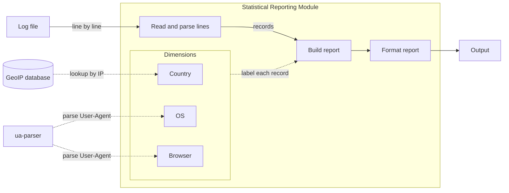

# Statistical Reporting Module Design

## Goal

Read an Apache web server log file and report what percentage of requests came from each Country, OS and Browser. Each metric will be reported separately, sorted by frequency (desc), with two decimal places.

## High-level Architecture

- Each line will be parsed, labelled and counted before the next one is read.
- Country will come from the GeoIP database.
- OS and Browser will come from ua-parser library.
- Both lookups will be cached, so repeated IPs and User-Agents usually won't be looked up again.
- New dimension won't change the pipeline.

| Component | What it does |
|---|---|
| `parse` | Reads a log line and takes out the IP, status, size and User-Agent |
| `lookups` | Finds the country of an IP using GeoIP database and the OS and browser of a User-Agent using ua-parser |
| `dimensions` | Country, OS and Browser. Each one gives a value for a request |
| `report` | Counts the requests per value for each dimension |
| `render` | Formats the report |
| `cli` | Reads the arguments and connects the parts |

## Key abstractions

| Abstraction | Interface |
|---|---|
| `Record` | One request: `ip`, `status`, `size`, `ua` |
| `Dimension` | `name`, `label(record) -> str` |
| `Report` | The counts per dimension and the total |
| `read_records(lines)` | Gives a `Record` for each line |
| `aggregate(records, dimensions)` | Counts the records and returns a `Report` |
| `render_text(report)` | Returns the report as text |

