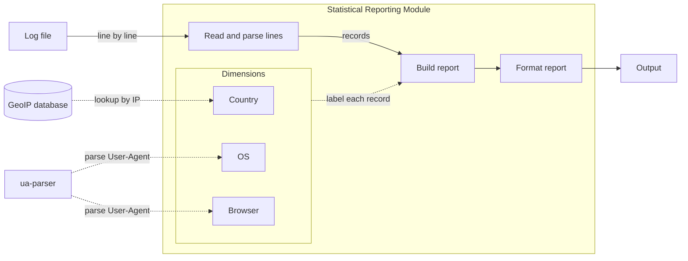

# Statistical Reporting Module Design

## Goal

Read an Apache web server log file and report what percentage of requests came from each Country, OS and Browser. Each metric will be reported separately, sorted by frequency (desc), with two decimal places.

## High-level Architecture

- Each line will be parsed, labelled and counted before the next one is read.
- Country will come from the GeoIP database.
- OS and Browser will come from ua-parser library.
- Both lookups will be cached, so repeated IPs and User-Agents usually won't be looked up again.
- New dimension won't change the pipeline.

| Component | What it does |
|---|---|
| `parse` | Reads a log line and takes out the IP, status, size and User-Agent |
| `lookups` | Finds the country of an IP using GeoIP database and the OS and browser of a User-Agent using ua-parser |
| `dimensions` | Country, OS and Browser. Each one gives a value for a request |
| `report` | Counts the requests per value for each dimension |
| `render` | Formats the report |
| `cli` | Reads the arguments and connects the parts |

## Key abstractions

| Abstraction | Interface |
|---|---|
| `Record` | One request: `ip`, `status`, `size`, `ua` |
| `Dimension` | `name`, `label(record) -> str` |
| `Report` | The counts per dimension and the total |
| `read_records(lines)` | Gives a `Record` for each line |
| `aggregate(records, dimensions)` | Counts the records and returns a `Report` |
| `render_text(report)` | Returns the report as text |

## Extensibility

- **New dimension:** add one entry to the dimension list, for example `Dimension("Status", lambda r: r.status)`. A dimension that needs a field `Record` doesn't have yet, like the HTTP method, will also change `Record` and the line pattern in `parse`.
- **New output format:** add a function next to `render_text`, for example one that writes JSON.
- **Top N:** show the N biggest values and group the rest into Other. Unknown stays a separate row.
- **New log format:** add a reader that returns the same `Record`.
- **Filtering:** add a step between reading and counting.
- **Bigger files:** see [Scaling](#scaling).

## Error strategy

- **Bad data in the log:** a line that doesn't parse or a value we can't find will be counted as Unknown, and the run will go on.
- **Can't run:** if the log or the database can't be read, or no line parses, the run will stop with an error.

## Scaling

- **Bigger files:** split the file, count each part in its own process, and add the reports.
- **Many files:** count each file on its own and add the reports.

## Technology choices

- **Python:** this is a small batch job. It doesn't need heavy concurrency or a compiled binary, where other languages are stronger. Python keeps the code short, and both lookups have mature libraries.
- **Regex for the log line:** the combined format is fixed and only four fields are needed, so one pattern takes them out with no extra dependency. A library like apache-log-parser would parse every field, including ones the report doesn't use.
- **geoip2 and ua-parser:** well-maintained libraries. geoip2 reads the GeoIP database, and ua-parser reads the OS and browser from a User-Agent.
- **uv, pytest, ruff:** dependencies, tests and linting.

## Trade-offs and assumptions

- Every non-blank line is one request, so the total will be 10,000.
- Every value will be listed. Unknown will mean we couldn't tell the value, for example a line we can't parse.
- Bots will be counted like any other request. They will show up as browsers, like Googlebot.
