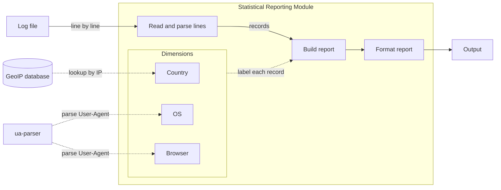
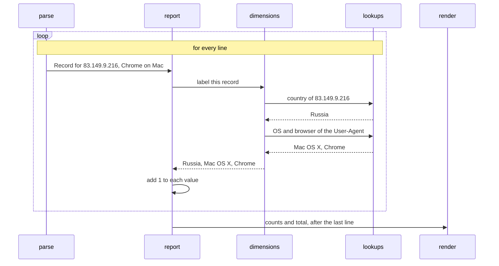

# Statistical Reporting Module Design

## Goal

Read an Apache web server log file and report what percentage of requests came from each Country, OS and Browser. Each metric will be reported separately, sorted by frequency (desc), with two decimal places.

## High-level Architecture



- Each line will be parsed, labelled and counted before the next one is read.
- Country will come from the GeoIP database.
- OS and Browser will come from the ua-parser library.
- Both lookups will be cached, so repeated IPs and User-Agents usually won't be looked up again.
- A new dimension won't change the pipeline.

| Component | What it does |
|---|---|
| `parse` | Reads a log line and takes out the IP, status, size and User-Agent |
| `lookups` | Finds the country of an IP using the GeoIP database and the OS and browser of a User-Agent using ua-parser |
| `dimensions` | Country, OS and Browser. Each one gives a value for a request |
| `report` | Counts the requests per value for each dimension |
| `render` | Formats the report |
| `cli` | Reads the arguments and connects the parts |

## Key abstractions

| Abstraction | Interface |
|---|---|
| `Record` | One request: `ip`, `status`, `size`, `ua` |
| `Dimension` | `name`, `label(record) -> str` |
| `Report` | The counts per dimension and the total |
| `read_records(lines)` | Gives a `Record` for each line |
| `aggregate(records, dimensions)` | Counts the records and returns a `Report` |
| `render_text(report)` | Returns the report as text |

### Example flow

Four lines from the Apache log file:

```
83.149.9.216 - - [17/May/2015:10:05:03 +0000] "GET /presentations/logstash-monitorama-2013/images/kibana-search.png HTTP/1.1" 200 203023 "http://semicomplete.com/presentations/logstash-monitorama-2013/" "Mozilla/5.0 (Macintosh; Intel Mac OS X 10_9_1) AppleWebKit/537.36 (KHTML, like Gecko) Chrome/32.0.1700.77 Safari/537.36"
24.236.252.67 - - [17/May/2015:10:05:40 +0000] "GET /favicon.ico HTTP/1.1" 200 3638 "-" "Mozilla/5.0 (X11; Ubuntu; Linux x86_64; rv:26.0) Gecko/20100101 Firefox/26.0"
200.49.190.101 - - [17/May/2015:10:05:36 +0000] "GET /reset.css HTTP/1.1" 200 1015 "-" "-"
68.184.202.186 - - [17/May/2015:11:05:58 +0000] "GET /favicon.ico HTTP/1.1" 200 3638 "-" "Mozilla/5.0 (Macintosh; Intel Mac OS X 10_8_5) AppleWebKit/537.36 (KHTML, like Gecko) Chrome/32.0.1700.107 Safari/537.36"
```

For each line, the parts will work like this (values are from the first line):



Step by step, for all 4 lines:

1. `read_records` will give a `Record` for each line. The first one will be:
   ```python
   Record(
       ip="83.149.9.216",
       status="200",
       size="203023",
       ua="Mozilla/5.0 (Macintosh; Intel Mac OS X 10_9_1) ... Chrome/32.0.1700.77 Safari/537.36",
   )
   ```
2. The lookups will find the values. The GeoIP database will give the country, and ua-parser the OS and browser:

   | IP | Country | User-Agent | OS | Browser |
   |---|---|---|---|---|
   | 83.149.9.216 | Russia | Mozilla/5.0 (Macintosh; ...) Chrome/32.0 ... | Mac OS X | Chrome |
   | 24.236.252.67 | United States | Mozilla/5.0 (X11; Ubuntu; ...) Firefox/26.0 | Ubuntu | Firefox |
   | 200.49.190.101 | Guatemala | `-` | Unknown | Unknown |
   | 68.184.202.186 | United States | Mozilla/5.0 (Macintosh; ...) Chrome/32.0 ... | Mac OS X | Chrome |

   The third line has no User-Agent, so its OS and browser will be Unknown.
3. `aggregate` will count each value. There are 4 requests, and United States, Mac OS X and Chrome appear twice.
4. `render_text` will format the report. Each metric will be sorted by frequency, so the values that appear twice come first:
   ```
   Country:
   United States 50.00%
   Guatemala 25.00%
   Russia 25.00%
   OS:
   Mac OS X 50.00%
   Ubuntu 25.00%
   Unknown 25.00%
   Browser:
   Chrome 50.00%
   Firefox 25.00%
   Unknown 25.00%
   ```

## Extensibility

- **New dimension:** add one entry to the dimension list, for example `Dimension("Status", lambda r: r.status)`. A dimension that needs a field `Record` doesn't have yet, like the HTTP method, will also change `Record` and the line pattern in `parse`.
- **New output format:** add a function next to `render_text`, for example one that writes JSON.
- **Top N:** show the N biggest values and group the rest into Other. Unknown stays a separate row.
- **New log format:** add a reader that returns the same `Record`.
- **Filtering:** add a step between reading and counting.
- **Bigger files:** see [Scaling](#scaling).

## Error strategy

- **Bad data in the log:** a line that doesn't parse or a value we can't find will be counted as Unknown, and the run will go on.
- **Can't run:** if the log or the database can't be read, or no line parses, the run will stop with an error.

## Scaling

- **Bigger files:** split the file, count each part in its own process, and add the reports.
- **Many files:** count each file on its own and add the reports.

## Technology choices

- **Python:** this is a small batch job. It doesn't need heavy concurrency or a compiled binary, where other languages are stronger. Python keeps the code short, and both lookups have mature libraries.
- **Regex for the log line:** the combined format is fixed and only four fields are needed, so one pattern takes them out with no extra dependency. A library like apache-log-parser would parse every field, including ones the report doesn't use.
- **geoip2 and ua-parser:** well-maintained libraries. geoip2 reads the GeoIP database, and ua-parser reads the OS and browser from a User-Agent.
- **uv, pytest, ruff:** dependencies, tests and linting.

## Alternatives considered

### Reading the log

| Option | Pros | Cons |
|---|---|---|
| **Line by line (chosen)** | Memory doesn't grow with the file | One pass only |
| Whole file in memory | Simple | Memory grows with the file |

### Lines that don't parse

| Option | Pros | Cons |
|---|---|---|
| Stop the run | Nothing is hidden | One bad line stops the report |
| Skip the line | Only clean data is counted | The total doesn't match the file |
| **Count as Unknown (chosen)** | Every request is counted | Unknown mixes bad lines with unknown values |

### Dimensions

| Option | Pros | Cons |
|---|---|---|
| A field per dimension | Checked by the type checker | Each new dimension changes the report and the output |
| **A list of `Dimension`s (chosen)** | A new dimension is one entry | Names are plain strings |

## Trade-offs and assumptions

- Every non-blank line is one request, so the total will be 10,000.
- Every value will be listed. Unknown will mean we couldn't tell the value, for example a line we can't parse.
- Bots will be counted like any other request. They will show up as browsers, like Googlebot.
